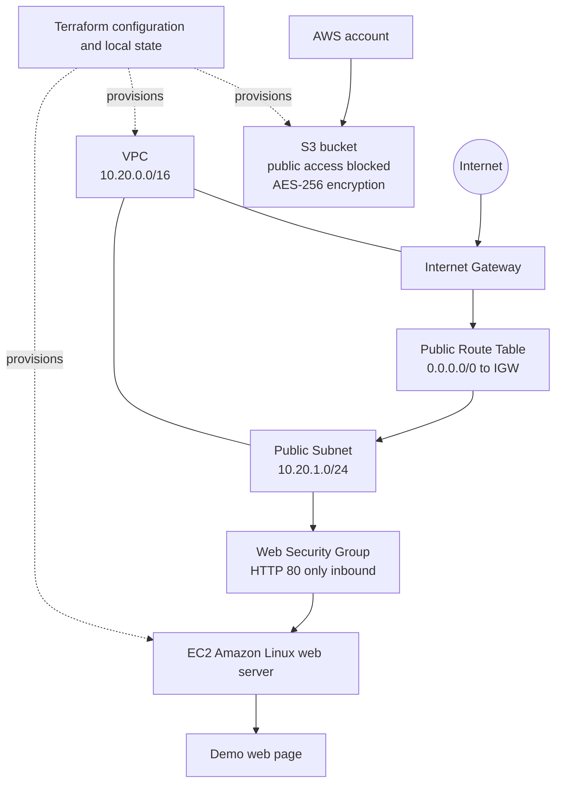

# Session 19: Cloud & Terraform in Action

This project uses Terraform to provision a small AWS environment with a VPC, a public subnet, an EC2 web server, and a private S3 bucket. It demonstrates provider configuration, variables, resources, dependencies, outputs, Terraform state, and the plan/apply/destroy workflow.

> **Cost and security:** EC2, public IPv4 addresses, and AWS network and storage operations may incur charges. The security group allows HTTP from the internet for this demonstration, but does not allow SSH. The S3 bucket blocks public access and uses server-side encryption. Do not store credentials in this project. Remove the demo resources when they are no longer needed.

## Architecture



The EC2 instance and S3 bucket are independent resources. Terraform establishes dependencies through resource references: for example, the subnet depends on the VPC, and the instance depends on its subnet and security group. The EC2 instance is not given access to the S3 bucket.

## Resources

| Resource | Purpose |
|---|---|
| VPC and public subnet | Isolated network and EC2 placement |
| Internet gateway and route table | Route public subnet traffic to the internet |
| Security group | Allow inbound HTTP on port 80; no inbound SSH |
| EC2 instance | Amazon Linux web server with a sample page |
| S3 bucket | Private storage with public access blocked and AES-256 encryption |

## Project files

```text
08-mini-project/
├── versions.tf
├── variables.tf
├── main.tf
├── outputs.tf
├── terraform.tfvars.example
├── .terraform.lock.hcl
├── .gitignore
├── README.md
└── screenshots/
```

- `versions.tf` sets the Terraform and AWS provider requirements.
- `variables.tf` declares the AWS region, EC2 instance type, and bucket name prefix.
- `main.tf` defines the AWS data sources and infrastructure.
- `outputs.tf` exposes resource IDs, the web page URL, and S3 bucket details.
- `.terraform.lock.hcl` records the selected provider version and checksums.
- Terraform state is stored locally and excluded from Git. Treat it as sensitive; do not share the state file.

## Requirements and configuration

The project requires Terraform 1.6 or newer, AWS CLI v2, and AWS credentials authorized to describe AMIs and Availability Zones and manage the resources listed above. Use an approved credential method such as AWS IAM Identity Center/SSO or a named AWS CLI profile; do not add access keys to Terraform files.

From the repository root, open the project directory in PowerShell:

```powershell
Set-Location .\session19-cloud-terraform\08-mini-project
```

For an AWS SSO profile, authenticate and confirm the account:

```powershell
aws sso login --profile YOUR_PROFILE
$env:AWS_PROFILE = "YOUR_PROFILE"
aws sts get-caller-identity
```

The example configuration uses `ap-south-1`, `t3.micro`, and a non-secret bucket prefix. To customize these values, copy the example and edit `terraform.tfvars`:

```powershell
Copy-Item terraform.tfvars.example terraform.tfvars
```

The bucket name includes the AWS account ID to reduce naming conflicts. If the name is already in use, change `bucket_name_prefix` in `terraform.tfvars`.

## Terraform workflow

Run these commands from `08-mini-project`:

```powershell
terraform init
terraform fmt
terraform validate
terraform plan
terraform apply
terraform state list
terraform show
terraform output
```

`terraform init` installs the provider, `terraform fmt` formats the configuration, and `terraform validate` checks its structure. `terraform plan` previews proposed changes. Review the AWS account, region, bucket name, and plan before approving `terraform apply` by entering `yes`.

After applying, `terraform state list` shows the resource addresses Terraform tracks. `terraform show` displays the current state, and `terraform output` prints values such as the instance ID, public IP, website URL, and bucket name. The web server may take a few minutes after the apply completes to install Apache and serve its page.

The AWS CLI can be used to check the deployed instance and S3 security settings:

```powershell
$instanceId = terraform output -raw instance_id
$bucket = terraform output -raw bucket_name
aws ec2 describe-instances --instance-ids $instanceId --query "Reservations[0].Instances[0].{State:State.Name,PublicIp:PublicIpAddress,SubnetId:SubnetId,VpcId:VpcId}"
aws s3api head-bucket --bucket $bucket
aws s3api get-public-access-block --bucket $bucket
aws s3api get-bucket-encryption --bucket $bucket
```

When the demo is complete, review the deletion plan and remove its resources:

```powershell
terraform plan -destroy
terraform destroy
```

Confirm that the plan only deletes this project’s resources, then enter `yes`. The bucket must be empty before Terraform can delete it. The screenshots below record a completed run, including successful cleanup.

## Screenshots

### Terraform initialization


### Formatting and validation


### Infrastructure plan


### Apply and outputs


### Terraform state inspection


### Deployed web page


### Cleanup


## Troubleshooting

- **Expired credentials or access denied:** Reauthenticate with the intended AWS profile and confirm the required permissions with an administrator.
- **Bucket name conflict:** Change `bucket_name_prefix` in `terraform.tfvars` and run `terraform plan` again.
- **AMI or Availability Zone lookup fails:** Confirm the selected AWS region is enabled for the account.
- **Web page does not load:** Allow time for EC2 user data to finish. Check that the instance is running, has a public IP, the subnet route points to the internet gateway, and the security group allows TCP port 80.
- **Bucket deletion fails:** Remove only the objects added for this demo and retry `terraform destroy`.
